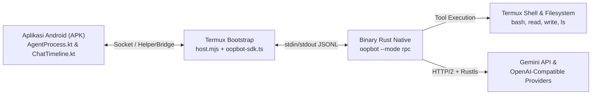

# OOPBoT — Hybrid Rust Agent Harness + Android App (Termux Rust Host)

Fondasi *agent harness* berbasis Rust yang menggabungkan:
1. **Binary CLI & RPC Native Rust (`oopbot`)** untuk Termux (`aarch64-linux-android`).
2. **Aplikasi Android (`android/`)** berbasis UI Pipkin yang terhubung kuat ke Termux (**Konsep 2: Termux Rust Host**) — menggunakan binary Rust `oopbot --mode rpc` (~2.9 MB) dan SDK bawaan (`oopbot-sdk.ts`) sebagai pengganti penuh `@earendil-works/pi-coding-agent` (`pi` Node.js ~150 MB).
3. **Shared Library C-ABI (`liboopbot.so`)** siap untuk ekspansi JNI in-process (Konsep 1).

Setiap rilis di GitHub Actions otomatis menghasilkan **3 artefak**:
1. **`oopbot-aarch64-linux-android`** — Binary CLI + RPC mandiri untuk Termux (`oopbot` & `oopbot --mode rpc`).
2. **`liboopbot-aarch64-linux-android.so`** — Shared library (`cdylib`) C-ABI (`jniLibs/arm64-v8a/liboopbot.so`).
3. **`oopbot-pipkin-<tag>-arm64.apk`** — APK Android siap pasang yang langsung menggunakan mesin Rust `oopbot` di Termux.

---

## Arsitektur Konsep 2: Android App ↔ Termux Rust Host (`oopbot --mode rpc`)



- **Tanpa `npm ci` 150 MB di Termux**: Saat aplikasi Android menjalankan mode `ensure` di Termux (`android/host/src/modes/ensure.ts`), host langsung mengunduh/menyalin binary native `oopbot-aarch64-linux-android` ke `$PIPKIN_ROOT/bin/oopbot` dan `$PREFIX/bin/oopbot`.
- **Manajemen Settings, Provider & Auto-Scan Model (`android/host/src/oopbot-sdk.ts`)**: Saat Anda menempelkan API key Google Gemini di menu **Settings → Providers** pada aplikasi Android, `oopbot-sdk.ts` otomatis memindai endpoint `/v1beta/models` dan menyimpan daftar model terbaru ke `models.json`.
- **Protokol RPC JSONL Penuh (`src/rpc.rs`)**: Setiap tab percakapan di aplikasi Android menjalankan `oopbot --mode rpc` yang mengirimkan stream event real-time (`thinking_start/end`, `toolcall_start/end`, `tool_execution_start/end`, `text_start/delta/end`, `turn_end`, `agent_end`, `agent_settled`) langsung ke komponen UI `ChatTimeline.kt` dan `StepFigure.kt`.

---

## Pasang di Termux (Mandiri / CLI)

```sh
pkg install -y curl
curl -fsSL https://raw.githubusercontent.com/Ahmadfauzi34/OOPBoT/main/install.sh | sh
```

Lalu isi API key atau gunakan `/token` di dalam sesi:
```sh
nano ~/.config/oopbot/.env     # GEMINI_API_KEY=xxxx
oopbot
```

---

## Perintah Interaktif & Slash Commands (CLI & Aplikasi Android)

```
oopbot [-m MODEL] [-p "PROMPT"] [-y] [--max-steps N] [--mode rpc] [--session PATH]
```

| Perintah | Fungsi |
|---|---|
| `/token <API_KEY> [BASE_URL]` | Simpan/ganti API key provider (opsional custom URL OpenAI-compatible/OpenRouter) dan otomatis scan daftar model |
| `/scan` | Pindai ulang daftar model langsung dari endpoint provider menggunakan token aktif (`/v1beta/models` atau `/v1/models`) |
| `/models` | Tampilkan katalog model & model aktif di tab saat ini |
| `/model <nomor\|id>` | Ganti model untuk tab aktif (misal `/model 2` atau `/model gemini-2.5-pro`) |
| `/tabs` | Lihat daftar semua tab sesi percakapan beserta model & jumlah langkahnya |
| `/new [model]` | Buat tab sesi baru (opsional langsung menentukan model) |
| `/tab <nomor\|id>` | Pindah antar-tab sesi |
| `/close <nomor\|id>` | Tutup tab sesi |
| `/steps` | Lihat lipatan proses kerja agen (`StepsFold`: `Thinking` + `ToolCall` beserta durasi ms) |
| `/clear` / `reset` | Bersihkan memori tab saat ini |

### Tool Bawaan

| Tool CLI (`oopbot`) | Nama di UI Android (`rpc`) | Fungsi |
|---|---|---|
| `run_shell` | `bash` | `sh -c <command>` dengan timeout, kembalikan exit code/stdout/stderr |
| `write_file` | `write` | Buat/timpa file (direktori induk dibuat otomatis) |
| `read_file` | `read` | Baca file teks |
| `list_dir` | `ls` | Daftar isi direktori |

---

## Struktur Modul (`src/` & `android/`)

| File | Peran |
|---|---|
| [`src/lib.rs`](src/lib.rs) | Entry point library (`rlib` + `cdylib` untuk `liboopbot.so`) |
| [`src/main.rs`](src/main.rs) | Entry point binary CLI & RPC Termux (`oopbot`) |
| [`src/rpc.rs`](src/rpc.rs) | Server JSONL RPC (`oopbot --mode rpc`) yang kompatibel dengan `AgentProcess.kt` & `ChatTimeline.kt` |
| [`src/agent.rs`](src/agent.rs) | Trait `Agent`, `GeminiAgent`, trait `Approver` |
| [`src/events.rs`](src/events.rs) | `AgentEvent`, trait `EventSink`, `TimelineEntry::StepsFold` |
| [`src/models.rs`](src/models.rs) | `ModelCatalog` & `ModelInfo` + parser live scan `/v1beta/models` & `/v1/models` |
| [`src/session.rs`](src/session.rs) | `WorkspaceTabs` & `ChatSession` (manajemen multi-tab CLI) |
| [`src/tools.rs`](src/tools.rs) | Trait `Tool`, `ToolRegistry`, dan implementasi tool |
| [`src/gemini.rs`](src/gemini.rs) | Klien HTTP dual-protocol: Google Gemini (`:generateContent`) & OpenAI-compatible (`/chat/completions`) |
| [`src/ffi.rs`](src/ffi.rs) | Ekspor simbol C-ABI (`oopbot_engine_new`, `oopbot_engine_request`, `oopbot_string_free`, `oopbot_engine_free`) |
| [`android/host/src/oopbot-sdk.ts`](android/host/src/oopbot-sdk.ts) | Pengganti ringan `@earendil-works/pi-coding-agent` SDK + auto-scan model Gemini |
| [`android/host/src/modes/ensure.ts`](android/host/src/modes/ensure.ts) | Pemasang otomatis binary Rust `oopbot` di Termux |
| [`android/host/src/modes/rpc.ts`](android/host/src/modes/rpc.ts) | Spawner `oopbot --mode rpc` untuk seluruh sesi percakapan Android |
