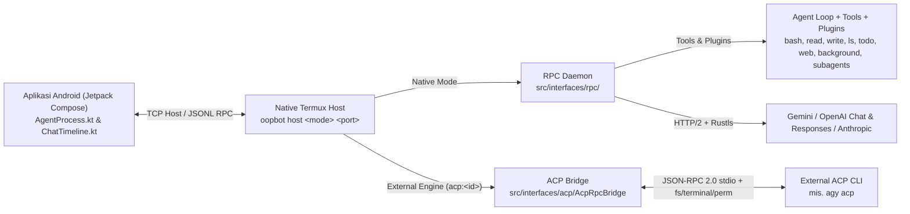

# OOPBoT — Hybrid Rust Agent Harness + Android App (Termux Rust Host & ACP Bridge)

**OOPBoT** adalah *agent harness* hybrid berbasis Rust yang menggabungkan:
1. **Binary CLI, RPC & Termux Host Native (`oopbot`)** untuk Termux (`aarch64-linux-android`) tanpa runtime Node.js.
2. **Aplikasi Android Kotlin/Jetpack Compose (`android/`)** yang terhubung langsung ke host Rust di Termux melalui `oopbot host` + protokol JSONL `--mode rpc`.
3. **External ACP Engine Bridge (`src/interfaces/acp/`)** untuk menjalankan agen CLI eksternal berbasis **Agent Client Protocol (ACP JSON-RPC 2.0 stdio)** seperti **Antigravity CLI (`agy acp`)** di dalam UI OOPBoT yang sama.
4. **Shared Library C-ABI & JNI (`liboopbot.so`)** yang dibundel di dalam APK (`jniLibs/arm64-v8a/liboopbot.so`).

Setiap rilis di GitHub Actions (`.github/workflows/build-termux.yml`) otomatis mempublikasikan:
1. **`oopbot-aarch64-linux-android`** — Binary tunggal CLI, JSONL RPC, ACP bridge, dan Termux TCP host (`+.sha256`).
2. **`liboopbot-aarch64-linux-android.so`** — Shared library (`cdylib`) C-ABI / JNI (`+.sha256`).
3. **`oopbot-<tag>-arm64.apk`** — APK Android signed R8 release (`+.sha256` + `mapping.txt`).

---

## Arsitektur Sistem



### Kemampuan Utama
- **Zero-Node.js Termux Native Host (`src/interfaces/host/`)**: Menggantikan daemon Node.js lama dengan binary Rust tunggal (`oopbot host ensure`, `rpc`, `providers`, `provider_models`, `sessions`, `files`, `terminal`, `git`, `engine_install`, `engine_login`, `engine_list`, `engine_uninstall`).
- **Multi-Provider LLM & Live Discovery (`src/llm/`, `src/config/`)**: Mendukung Google Gemini (`:generateContent` + sanitasi skema tool), OpenAI Chat Completions, OpenAI Responses (`/responses`), Anthropic Messages (`/v1/messages`), serta OpenRouter, DeepSeek, Z.ai, Kimi, dan endpoint OpenAI-compatible kustom dengan auto-scan katalog model & penyimpanan kredensial `auth.json` (`0o600`).
- **Agent Harness & Sistem Plugin Modular (`src/agent/`, `src/tools/`, `src/plugins/`)**:
  - **Built-in Tools**: `run_shell` (`bash`), `read_file` (`read`), `write_file` (`write`), `list_dir` (`ls`).
  - **Built-in Plugins**: `todo` (perencanaan tugas & replay branch), `web_search` / `fetch_page` (fallback multi-engine DDG/Tavily/Brave/Serper/SearXNG/Gemini Grounding), `background` (manajemen proses panjang non-blocking + wake-up otomatis), `interact` (`ask_user` / `notify_user`), dan `subagents`.
- **External ACP Engine Bridge (`src/interfaces/acp/`)**:
  - Handshake `initialize` + pemulihan sesi `session/load` & mirror JSONL lokal (`acpSessionId` & `session_info`).
  - Translasi stream `session/update` (`agent_thought_chunk`, `agent_message_chunk`, `tool_call`, `tool_call_update` progresif, `plan`, `available_commands_update`, `session_info_update`, `current_mode_update`, `usage_update`, `config_option_update`).
  - Callback Agent → Client: `fs/read_text_file`, `fs/write_text_file` (dengan ekspansi `~/`), siklus `terminal/{create,output,wait_for_exit,kill,release}` non-blocking dengan cleanup process-tree, serta `session/request_permission` yang dipetakan ke dialog native Android `extension_ui_request` (`select` / `confirm`).
  - Pemilih model & thinking level ACP (`set_model`, `set_thinking_level`, `cycle_model`, `cycle_thinking_level`), antrean `steer`/`follow_up`, `get_commands`, `get_session_stats`, dan `export_html`.

---

## Pasang di Termux (Mandiri / CLI)

```sh
pkg install -y curl
curl -fsSL https://raw.githubusercontent.com/Ahmadfauzi34/OOPBoT/main/install.sh | sh
```

Atur API key provider pilihan Anda (mis. Gemini, OpenRouter, DeepSeek, OpenAI, Anthropic) atau simpan di `~/.config/oopbot/.env`:

```sh
export GEMINI_API_KEY=...
# atau OPENROUTER_API_KEY=... / DEEPSEEK_API_KEY=... / OPENAI_API_KEY=... / ANTHROPIC_API_KEY=...

oopbot
```

> Untuk penggunaan bersama **Aplikasi Android OOPBoT**, layar onboarding di aplikasi menyediakan perintah persiapan Termux satu-tempel (`RunCommandService`) serta pemasangan **External ACP Engine** (seperti Antigravity CLI + OAuth browser/kode manual) langsung dari menu **Providers / Engine Setup**.

---

## Perintah CLI & Slash Commands

```sh
oopbot [-m MODEL] [-p "PROMPT"] [-y] [--max-steps N] [--mode rpc|host|scan-models] [--session PATH]
```

| Perintah | Fungsi |
|---|---|
| `/token <API_KEY> [BASE_URL]` | Simpan API key ke `~/.config/oopbot/.env` dan pindai daftar model provider |
| `/scan` | Pindai ulang daftar model live dari endpoint provider aktif |
| `/models` | Tampilkan katalog model & model aktif pada tab saat ini |
| `/model <nomor\|id>` | Ganti model aktif (mis. `/model gemini-2.5-pro`) |
| `/thinking [level]` | Lihat atau ubah level reasoning (`off`, `minimal`, `low`, `medium`, `high`, `xhigh`) |
| `/tabs` | Lihat daftar semua tab sesi percakapan beserta model & jumlah langkah |
| `/new [model]` | Buat tab sesi baru (opsional langsung menentukan model) |
| `/tab <nomor\|id>` | Berpindah antar-tab sesi |
| `/close <nomor\|id>` | Tutup tab sesi |
| `/steps` | Lihat ringkasan *StepsFold* (`Thinking` + `ToolCall` + durasi) |
| `/clear` / `/reset` | Bersihkan riwayat pesan pada tab saat ini |

### Pemetaan Tool UI Android

| Tool / ACP Kind | Nama di UI Android | Fungsi |
|---|---|---|
| `run_shell` / `execute` / `bash` | `bash` | Eksekusi shell command (`bash -c` / `sh -c`) dengan batas timeout & deteksi command berbahaya |
| `write_file` / `write` | `write` | Membuat atau menimpa file teks secara penuh |
| `edit_file` / `edit` | `edit` | Edit parsial atomik berbasis search-and-replace dengan diff bernomor & badge `+N/-M` |
| `read_file` / `read` | `read` | Membaca isi file teks |
| `list_dir` | `ls` | Mendaftar isi direktori |

---

## Struktur Repositori (4-Layer DAG)

| Direktori / File | Peran |
|---|---|
| [`src/common/`](src/common/) | Fondasi netral: `BoxError`, utilitas I/O atomik (`fs.rs`), waktu ISO/epoch (`time.rs`) |
| [`src/config/`](src/config/) | Katalog model, builtin providers, auto-discovery `/models`, store config (`auth.json`, `models.json`, `settings.json`), katalog engine eksternal (`engines.rs`) |
| [`src/llm/`](src/llm/) | Klien HTTP/2 multi-protokol (`gemini.rs`, `openai_chat.rs`, `openai_responses.rs`, `anthropic.rs`) |
| [`src/tools/`](src/tools/) | Trait `Tool`, `ToolRegistry`, implementasi tool filesystem & shell |
| [`src/agent/`](src/agent/) | Headless agent loop (`runner.rs`, `events.rs`, `session.rs`), tanpa I/O terminal |
| [`src/plugins/`](src/plugins/) | Trait `Plugin` & plugin bawaan (`todo/`, `web_access/`, `background/`, `interact.rs`, `subagents`) |
| [`src/interfaces/cli/`](src/interfaces/cli/) | Antarmuka CLI Termux (argumen, REPL, slash commands, renderer terminal) |
| [`src/interfaces/rpc/`](src/interfaces/rpc/) | Daemon JSONL `--mode rpc`, antrean prompt/steer/follow-up, compaction, approver UI |
| [`src/interfaces/host/`](src/interfaces/host/) | Bridge TCP `oopbot host <mode> <port>` (manajemen file, git, terminal, sesi, backup, engine CLI) |
| [`src/interfaces/acp/`](src/interfaces/acp/) | Klien & bridge ACP JSON-RPC 2.0 stdio (`protocol.rs`, `client.rs`, `client_ops.rs`, `bridge.rs`) |
| [`src/interfaces/ffi/`](src/interfaces/ffi/) | Ekspor C-ABI & JNI Android (`liboopbot.so`) |
| [`android/`](android/) | Aplikasi Android Kotlin/Jetpack Compose (`AgentProcess.kt`, `ChatController.kt`, `ChatTimeline.kt`, `HostClient.kt`, `ProvidersScreens.kt`, `EngineSetupSheet.kt`) |
| [`tests/host_binary_wire.rs`](tests/host_binary_wire.rs) | Tes integrasi wire protocol binary `oopbot host` |

---

## Verifikasi & Pengembangan

```sh
# Rust lint & seluruh unit + integration tests
cargo clippy --all-targets --locked -- -D warnings
cargo test --locked -- --test-threads=2

# Android lint, detekt, unit test & host TS check (di folder android/)
pnpm --dir android/host test
./android/gradlew -p android ktlintCheck detekt testDebugUnitTest
```

